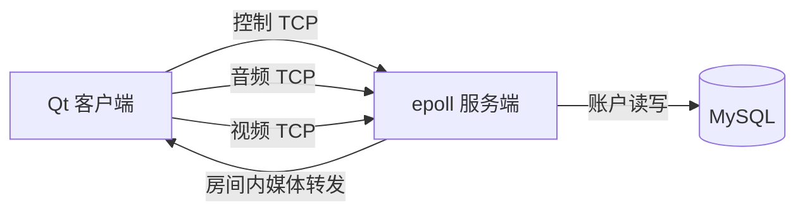

# 多人音视频会议系统

Qt 桌面客户端与 Linux C++ 服务端组成的多人会议原型，支持账户注册登录、房间成员管理、摄像头视频、桌面截图和语音。服务端使用 TCP、`epoll`、线程池和 MySQL；客户端使用 Qt Widgets、OpenCV、Qt Multimedia 和 Speex。

## 代码结构

| 路径 | 内容 |
| --- | --- |
| `WeChat/` | Qt 客户端、窗口、TCP 网络及音视频模块 |
| `Server/` | Linux 服务端、epoll 网络层、消息分发和 MySQL 访问 |
| `docs/architecture.md` | 进程、连接和媒体数据流 |
| `docs/protocol.md` | 私有 TCP 消息协议与兼容性边界 |
| `docs/database.md` | 数据库初始化和当前配置方式 |
| `docs/limitations.md` | 已知限制与后续改进方向 |
| `docs/planning/archive/` | 历史 XMind 原件与自动保存副本 |

## 架构

每个客户端会向同一服务端端口建立控制、音频和视频三条 TCP 连接。登录后，客户端将用户 ID 注册到音视频连接，服务端记录 socket 并按房间成员转发数据。桌面截图复用视频帧通道。



代码入口和数据流见[架构说明](docs/architecture.md)。协议在客户端和服务端分别定义，修改时必须保持一致。

## 构建环境

**服务端：** Linux、C++11 GCC、qmake、make，以及 MySQL 客户端开发头文件和库。`Server/Server.pro` 使用 `-lmysqlclient` 和 pthread；入口为 `Server/src/main.cpp`，监听端口默认为 `8000`。

```bash
cd Server
qmake Server.pro
make -j
```

**客户端：** Windows、Qt 5.12 Widgets 和 Multimedia、MinGW 32 位编译器、OpenCV 4.2 MinGW 库，以及仓库提供的 Speex 库。客户端工程为 `WeChat/WeChat.pro`，对应的 `.ui` 和 `resource.qrc` 均已纳入仓库。

当前 `WeChat/VideoApi/videoapi.pri` 使用作者本机的 OpenCV 绝对路径。在其他机器上构建前，需将 `INCLUDEPATH` 和 `LIBS` 改成该机器上兼容的 OpenCV 4.2 MinGW 路径。运行时也需提供所需 DLL，并配置可执行文件旁的 `config.ini`。Linux 服务端可独立构建。

## 数据库和运行

账户存储在 MySQL 的 `WeChat.t_user` 表。本地运行前请按[数据库说明](docs/database.md)创建表并为服务端设置数据库连接。源码当前将连接参数写在 `Server/include/packdef.h` 中；公开部署前应改用本地配置或环境变量，避免提交账号口令。

客户端通过程序旁的 `config.ini` 选择服务器 IP：

```ini
[Net]
ip=127.0.0.1
```

局域网内跨设备测试时，将 IP 改成运行服务端的机器地址，并允许防火墙的 TCP `8000` 端口。进入房间后，可单独打开麦克风，或在摄像头与桌面采集之间切换。

## 项目边界

这是教学和演示原型，不应直接暴露到公共互联网。当前协议传输原生 C++ 结构体，SQL 查询使用字符串拼接，密码使用 MD5，媒体帧缺少统一的大小限制和慢客户端背压。详见[已知限制](docs/limitations.md)。仓库目前没有自动化测试。
